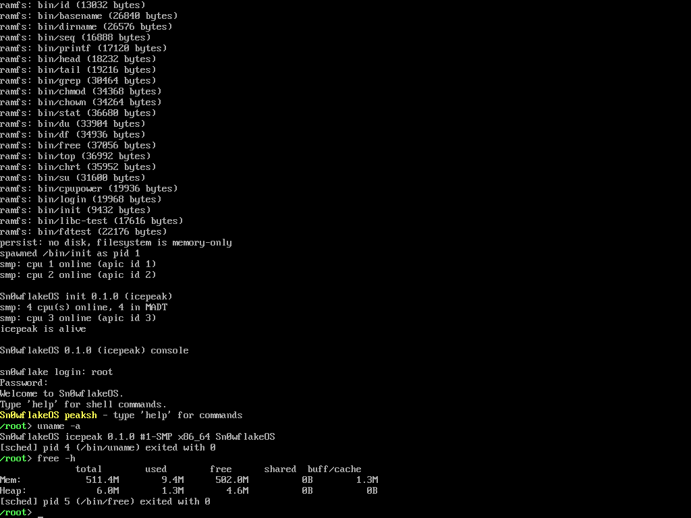

# Sn0wflakeOS

Sn0wflakeOS is a hobby operating system built around **icepeak**, a clean-room
x86_64 kernel written in Rust with an assembly boot path. It boots from BIOS
and UEFI, drops into ring 3, and lands on a working shell with coreutils.

[](../../releases)
[](#release-state)
[](kernel/src)
[](boot)
[](#what-works)
[](#what-works)
[](LICENSE)



## Release state

Current version: **0.1.0-alpha**.

Alpha means the system boots, runs user programs and keeps a filesystem, but
the ABI, the disk format and the boot protocol can still change between
releases. There is no upgrade path yet, data written by one build may not be
readable by the next one, and only QEMU is a tested target. Nothing here is
production ready and there is no warranty.

The screenshot above is a real 0.1.0 boot in QEMU: `uname -a` reports
`Sn0wflakeOS icepeak 0.1.0 #1-SMP x86_64` and `free -h` shows about 9 MiB of
the 512 MiB guest in use after login.

## What works

- **Boot:** custom two-stage BIOS loader and a UEFI loader, packed into an El
  Torito ISO with a FAT EFI system partition.
- **Kernel:** `no_std` Rust, long mode only, one page table per process, a
  6 MiB kernel heap and a bitmap frame allocator.
- **CPU:** SMP bring-up for up to 8 CPUs, preemptive scheduling, 64 tasks,
  `SCHED_OTHER`/`FIFO`/`RR` with priorities 0..99, per-CPU idle contexts and
  reschedule IPIs.
- **User mode:** ring 3, static ELF64 binaries, a small syscall ABI shared with
  userland through `abi/src/lib.rs`, argument passing, spawn and wait. A fault
  in a user program kills that task only; the shell survives.
- **Console:** linear framebuffer through VBE or GOP with an embedded 8x16
  font, an ANSI subset, incremental repaint and a VGA text fallback.
- **Drivers:** PS/2 keyboard, 16550 UART, PC speaker, ATA PIO disk.
- **ACPI:** FADT, MADT, MCFG, HPET and DSDT `_S5`, parsed in tree. APIC,
  TSC/HPET/PIT clocks, C1/C2/C3 idle states, `schedutil`/`performance`/
  `powersave` governors, Intel HWP/EIST and AMD CPPC.
- **Filesystem:** ramfs with POSIX modes, uid/gid, symlinks and pipes, a
  per-process descriptor table, a Nix-style store at `/nix/store`, and an
  append-only journal on the ATA disk that survives a reboot.
- **Pseudo-files:** `/proc/meminfo`, `/proc/cpuinfo`, `/proc/uptime`,
  `/proc/version`, `/dev/null` and `/dev/zero`.
- **Userland:** `init`, `login`, and `peaksh`, a fish-like shell with
  autocomplete, colors, quotes, variables, `&&`/`||`, redirection and real
  pipes. Around 40 programs ship in the image.
- **Toolchain:** a freestanding C libc, `tools/snf-cc` and `crt0` for building
  static ELF64 programs against it.

## Build

The host needs Rust (edition 2024), `nasm`, `xorriso`, `mtools`, a C compiler,
binutils and QEMU. The Nix flake provides all of them:

```sh
nix develop
./build.sh release      # dev is the default profile if you omit the argument
```

Output is `sn0wflake.iso`. The release profile is a single codegen unit,
`opt-level = "z"`, LTO, stripped.

## Run

```sh
./run.sh          # BIOS, graphical QEMU window
./run.sh uefi     # UEFI through OVMF, serial console
./run.sh debug    # BIOS with a GDB stub on :1234
DISK=disk.img ./run.sh   # attach a 64 MiB disk for the journal
```

Log in as `user` (no password) or `root` (password `root`).

## Tests

The suite boots the ISO in QEMU and drives the serial console:

```sh
nix develop --command ./tools/suite.sh            # BIOS
UEFI=1 nix develop --command ./tools/suite.sh     # UEFI
nix develop --command ./tools/matrix.sh           # dev and release, both firmware
```

Covered: coreutils, shell syntax, pipelines, login and the store layout, the C
libc, `/proc` and `/dev`, tickless idle, SMP stress, ring-3 fault containment,
typed input under load and framebuffer rendering.

## Layout

```
abi/        syscall numbers and flags shared by kernel and userland
boot/       BIOS entry stubs and the interrupt entry table
boot2/      stage1, stage2, the UEFI loader and the AP trampoline
kernel/src/ kernel: arch, mm, sched, fs, drivers, syscall, console
libc/       freestanding C library and its headers
user/       Rust user programs, including peaksh
tools/      test drivers, QEMU helpers, the boot packer and snf-cc
build.sh    assembles, builds userland and kernel, packs the ISO
```

## Roadmap

The detailed plan lives in [ROADMAP.md](ROADMAP.md). Short version:

- **Next:** demand paging with copy-on-write, a frozen `snf-abi`, `fork`/
  `waitpid`/signals/`mmap`, a TTY line discipline and job control.
- **Then:** W^X, guard pages, ASLR, crash dumps, a persistent root instead of
  a replayed log, and a real package store.
- **Later:** 32-bit x86 port, networking, a graphics stack, an audio server
  and a system manager.

Not started, and not pretended otherwise: network drivers, Mesa, Wayland,
PipeWire, OpenSSH and Python.

## History

In late 2024 I found a friend's hobby OS, `tlp-osk`, and forked it as
`zsd-osk` to learn how a desktop OS works. It spread through the Obsuzhdenie
Zhori Telegram chat, where people built distributions around it. The largest
was RibidiumZSD, developed from 18 February 2025 to 1 July 2025 and then
handed to me after its author hit the IDT and keyboard driver wall.

That code was a mess and much of it was AI generated. The first icepeak,
0.0.1, was forked from `zsd-osk` with RibidiumZSD fixes merged in. In autumn
2026 I rebuilt it as a clean-room implementation from the behaviour of the old
ISO: new kernel, new boot path, new userland, no copied code.

## Credits

- D7TUN6: Sn0wflakeOS, icepeak, zsd-osk
- TheLittlePony: tlp-osk
- MirAway: RibidiumZSD / Mallok

Ideas and prior art: NixOS, Guix, Alpine, the BSDs, Linux, BTRFS, ZFS,
Wayland, PipeWire and Mesa.

## Contributing

Read [CONTRIBUTING.md](CONTRIBUTING.md) for the build, test and review rules.
Visual direction is in [DESIGN.md](DESIGN.md).

## License

MIT. See [LICENSE](LICENSE).
